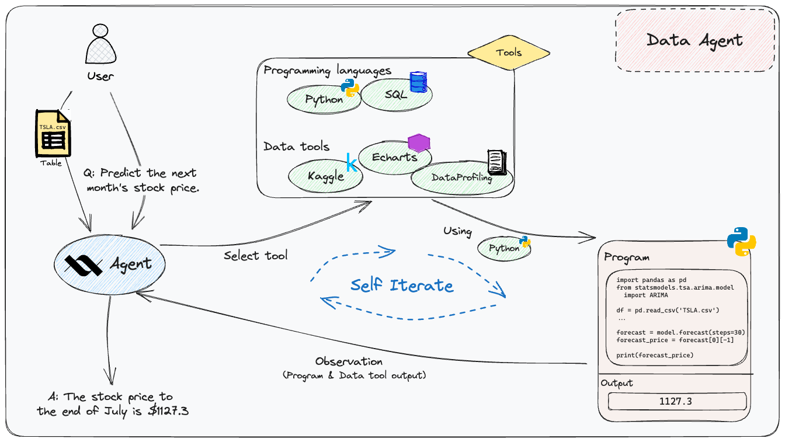

# Data Agent

    

[Data Agent](https://github.com/xlang-ai/xlang_agents/tree/code_clean/real_agents/data_agent) is a comprehensive toolkit designed for efficient data operations. It provides capabilities to:

- 🔍 **Search**: Quickly locate the data you need.
- 🛠️ **Handle**: Streamline data acquisition and processing.
- 🔄 **Manipulate**: Modify data to suit specific requirements.
- 📊 **Visualize**: Represent data in a clear and insightful manner.

With its proficiency in writing and executing code, Data Agent simplifies a wide range of data-centric tasks. Discover its potential through various [use cases](https://docs.xlang.ai/use-cases/data-agent).

Generated Python execution is **disabled by default**, including when constructing
`PythonEvaluator`, `PythonChain` or `CodeGenerationExecutor` directly. Python analysis
and Python-generated charts require an operator-selected mode. Local execution
runs with backend privileges and requires explicit acknowledgement; the legacy
Docker interpreter is not a verified untrusted-user sandbox. See the
[execution trust boundary and migration guide](../../backend/README.md#python-execution-trust-boundary).
